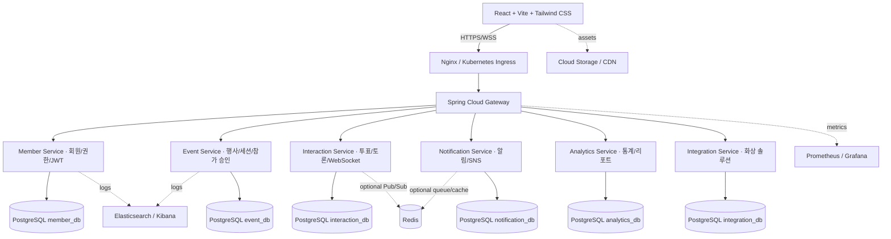

# 목표 아키텍처 — 6개 마이크로서비스

## 핵심 결정 사항
- 이전 **Auth Service → Member Service**, **Registration Service → Event Service의 기능으로 통합**. 6개 구성은 Member / Event / Interaction / Notification / Analytics / Integration.
- Nginx는 정적 SPA 제공 및 reverse proxy/Ingress 진입점, Gateway는 API 라우팅·인증 연계·제한 정책 수행. TLS 종료 지점은 배포별로 문서화.
- PostgreSQL는 개발용 물리 인스턴스 하나를 공유해도 **서비스별 논리 DB/스키마와 DB 계정 소유권을 분리**. 교차 서비스 직접 SQL, DB 간 FK 금지.
- 서비스 통신: 동기 REST(타임아웃, 오류 처리, 서비스 인증). Kafka/gRPC는 범위 제외; 통계는 초기 Event API 직접 집계.
- Member에서 JWT 발급; 게이트웨이와 서비스 자체에서 서명, 만료, 역할, 리소스 소유권 검증. 서비스 간 인증도 별도 처리.
- Event는 행사/세션/신청/승인/정원 동시성 제어를 소유. Interaction은 행사 참가 승인 상태를 Event API로 확인하고 중복 투표를 DB 제약으로 방지.
- WebSocket: WSS 경유, 업그레이드 헤더/연결 시간 초과/인증·구독 권한 및 재연결 검사 필수. Redis는 다중 인스턴스에서 메시지 분산이 필요할 때 사용.
- Integration은 외부 Zoom/Jitsi **참여 URL/회의 메타데이터** 관리부터 시작. 제공자 OAuth/SDK는 연동 단계에서 별도 결정.
- Notification은 앱 내 알림 및 SNS 연동을 소유; SNS 공유 링크 제공은 P0 화면에서 가능. 비밀 API 키는 코드 저장 금지.
- Analytics는 읽기 전용 지표/리포트 API를 소유하며 이후 이벤트 기반 집계로 전환 가능.
- Prometheus/Grafana는 메트릭, Elasticsearch/Kibana는 로그 검색으로 역할이 다름. CDN/Cloud Storage는 정적 리소스 및 파일 저장.

## 4주 현실적 배치
Phase 1 (P0): Member + Event + Interaction, React, Nginx, Gateway, PostgreSQL; 기본 대시보드 통계는 Event에서 구현.
Phase 2 (P1): Notification + Analytics + Integration 독립 서비스로 추출·확장, Redis, 운영 스택 및 Kubernetes/OpenShift.
목표 아키텍처의 6개 서비스를 처음부터 모두 완성했다고 표기하지 않는다.
